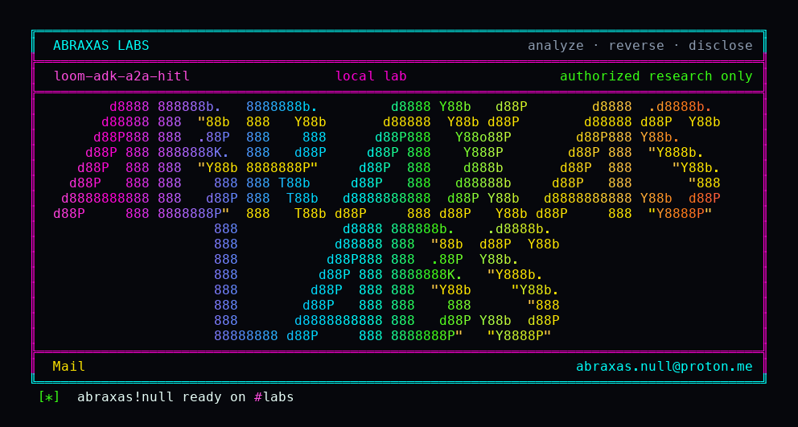

<p align="center">
  
</p>

# loom-adk-a2a-hitl

Loom attaches an approval check to every ADK tool, including the tool that sends a message to another agent. In google-adk 2.13.0 that send tool never calls the check. The message goes out. The same empty or star rule still pauses an ordinary ADK function and the Strands partner tool.

The caller already has `invoke` on that agent. This is not an anonymous bug, and it is not a shell. The lab counted predicate calls. It did not claim the partner did anything beyond receiving the send.

**Class:** Approval check bound but never awaited
**Reach:** Remote. In-group `invoke` on an ADK agent that already has agent-to-agent enabled. `google-adk==2.13.0`.

**[Loom](https://github.com/awslabs/loom)** [v1.9.0](https://github.com/awslabs/loom/releases/tag/v1.9.0) `a3050669` and [v1.10.3](https://github.com/awslabs/loom/releases/tag/v1.10.3) `cc10ab0`

| | |
|---|---|
| ID | no CVE yet |
| Class | **ADK `AgentTool` skips the confirmation predicate** |
| Reach | **Remote**, in-group `invoke` |
| CWE | [CWE-862](https://cwe.mitre.org/data/definitions/862.html) |
| CVSS | **Medium: 6.5** `CVSS:3.1/AV:N/AC:L/PR:L/UI:N/S:U/C:N/I:H/A:N` |
| Product | [awslabs/loom](https://github.com/awslabs/loom) |
| Affected | **v1.9.0** and **v1.10.3**, with `google-adk[a2a,extensions,mcp]==2.13.0` |
| Auth | `invoke` on that agent |
| License | [GNU Affero GPL v3.0](LICENSE) |
| Lab | loopback Docker on v1.9.0. The dependency pin is unchanged on v1.10.3. |

## What an attacker can do

| Privilege | Method / sink | Impact | Lab-proven or inferred |
|---|---|---|---|
| Have an ordinary ADK function pause | `FunctionTool.run_async` under an empty or star rule | The predicate runs | Lab-proven. Would pause. |
| Send through the A2A tool without the predicate | `AgentTool.run_async` | Integrity. Predicate calls stay 0 and the tool completes. | Lab-proven |
| Have Strands pause on the same rule | `a2a_partner` | Contrast | Lab-proven. Would pause. |

**Stays closed**

| Axis | Method / sink | Why it is closed |
|---|---|---|
| Integrity | Strands partner tool | The hook still pauses it |
| Integrity | ADK `FunctionTool` | The predicate is awaited |
| Integrity | Anonymous websocket | Closed elsewhere. This lab does not reopen it. |
| Integrity | HTTP payload for Strands | Still includes `approval_policies` |

## How I found it

`apply_confirmation_to_tools` rebinds `check_require_confirmation` on each tool. The A2A helper returns `AgentTool`. I stepped through `AgentTool.run_async` in 2.13.0 and the rebound method is not awaited. `FunctionTool.run_async` does await it. The pin in `agents/adk_agent/requirements.txt` is still 2.13.0 on v1.10.3, and this file was not in the v1.10 security commits.

The container ran on v1.9.0.

## Lab

```bash
python3 loom-adk-a2a-hitl-Abraxas-Labs.py
```

```text
SUCCESS LOOM-190-ADK-A2A-HITL agenttool-predicate-calls=0 LOOM-190-ADK-A2A-HITL-WITNESS
```

## The fix

Wrap the remote agent in a tool whose `run_async` awaits `check_require_confirmation` before the send, or stop using `AgentTool` until upstream does. A pin bump only helps if the new `AgentTool` actually awaits the predicate.

## References

- [awslabs/loom v1.10.3](https://github.com/awslabs/loom/releases/tag/v1.10.3) `cc10ab08573087fa12154f7c8181ffcd985fea88`
- [`approval.py` `apply_confirmation_to_tools`](https://github.com/awslabs/loom/blob/cc10ab08573087fa12154f7c8181ffcd985fea88/agents/adk_agent/src/integrations/approval.py#L158)
- [`a2a_client.py`](https://github.com/awslabs/loom/blob/cc10ab08573087fa12154f7c8181ffcd985fea88/agents/adk_agent/src/integrations/a2a_client.py#L168)
- [CWE-862](https://cwe.mitre.org/data/definitions/862.html)
- [CVSS 3.1 calculator](https://www.first.org/cvss/calculator/3.1#CVSS:3.1/AV:N/AC:L/PR:L/UI:N/S:U/C:N/I:H/A:N)


## License

GNU Affero GPL v3.0. See [LICENSE](LICENSE). Loopback lab only. No warranty.

Abraxas Labs
abraxas.null@proton.me
